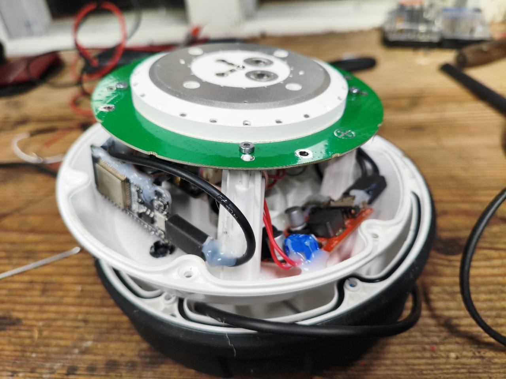
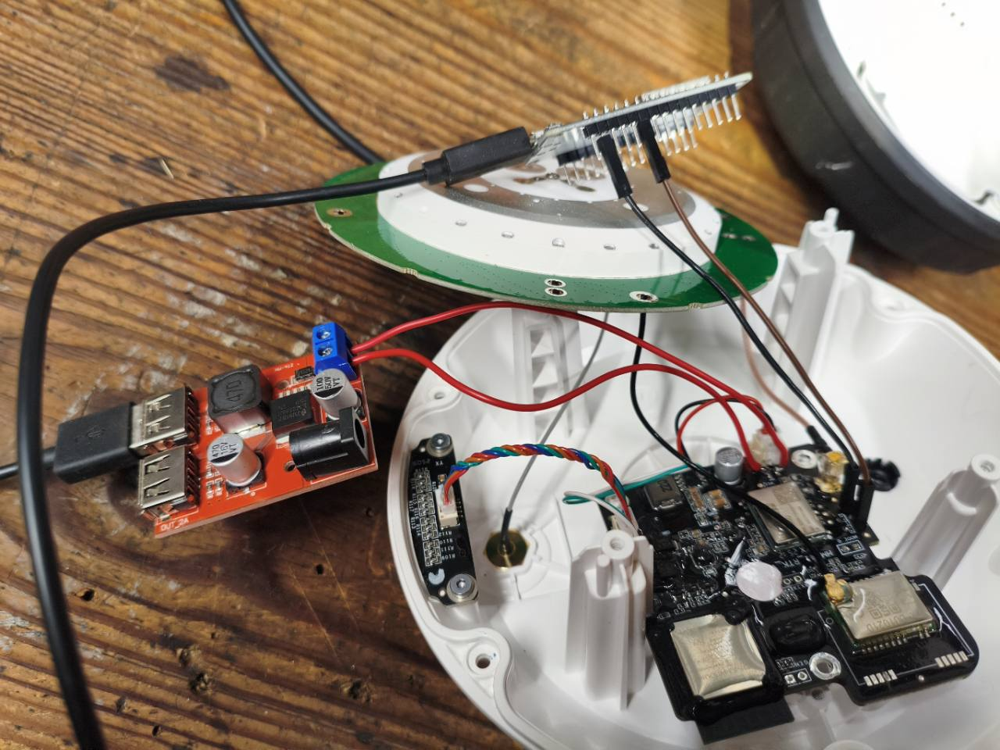
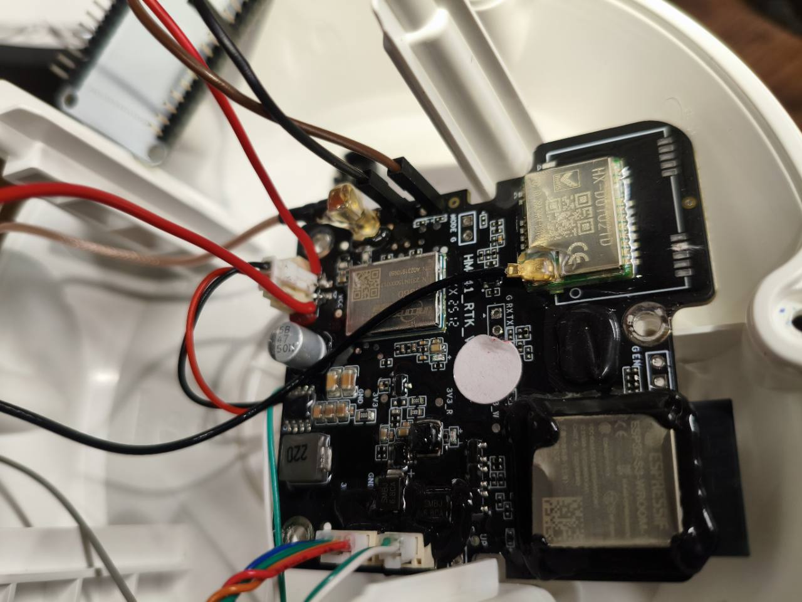
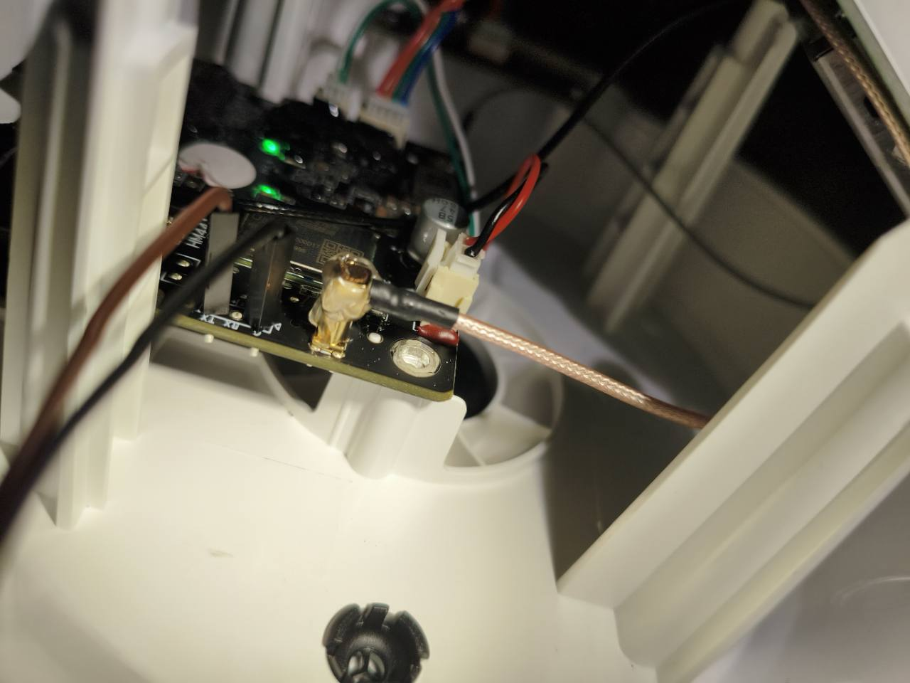

project for taking out rtcm data from  mammotion rtk301,,  opened gps base theres main board  at side of um960 chip Tx Rx Ground pins , need only TX and Ground, wired to esp32 d16  and ground,  constant data avaible from those pins but mixed with nmea data so you cannot use this directly, i let ai  to modify nebkat/esp32 xbee  software just to add filter to pass only through rtcm data,  and thats it evrything else  works exactly same as original ntrip-master from nebkat software , it connects to my local wifi and sends rtcm data to rtk2go caster.   i tested with f9p rover  and got good results  rtk fix in ca 30 second from boot.   only limitation is that um960 broadcasts only msm3 data evry 4 seconds.   used cheap esp32 wroom32 and wide range dc to usb 5v adapter  since input voltage is about 28v  

# Mammotion RTK301 → ESP32 → RTK2go

1. **Wire** verified 3.3 V UART out → ESP32-WROOM-32 GPIO16, with common GND. Leave ESP32 TX disconnected. Input: **460800 8N1**.
2. **Flash** [the firmware ZIP](mammotion-xbee-flash.zip) using its `flash_args` for image offsets and settings.
3. **Configure** at [192.168.4.1](http://192.168.4.1) on the `ESP_XBee_…` hotspot. Set Wi-Fi Station and NTRIP Server to `rtk2go.com:2101` with your mountpoint and Rev1 source password. Save and reboot.

**Why custom firmware?** The RTK301’s Unicore UM960 UART mixes RTCM3 corrections with NMEA and other data. The ESP32 forwards only CRC-valid RTCM3 frames to RTK2go. The Mammotion firmware stays untouched.

**Observed RTK301 output:** MSM3 only for observations (`1073/1083/1093/1123`, every ~4 s), plus base position `1006` and receiver/antenna descriptor `1033` (~10 s). No MSM4 or `1230` seen.

Source for the same firmware: [source ZIP](mammotion-esp32-xbee-rtcm.zip) · ESP-IDF 4.4.8 · Based on [nebkat/esp32-xbee](https://github.com/nebkat/esp32-xbee), GPL-3.0.

**Project credit:** OpenAI’s GPT-6.1 Sol, working through Codex, wrote the custom ESP32 firmware changes and created and published this GitHub repository.

## Hardware photos

*Open RTK301 housing with the ESP32 installed*

*ESP32 and RTK301 bench wiring*

*RTK301 mainboard close-up*

*Close-up of the board connections*
